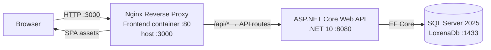
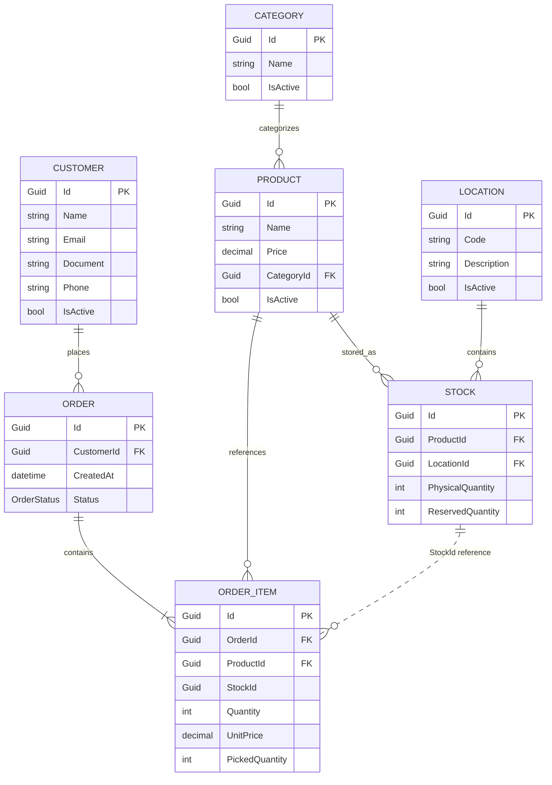

# WMS Loxena

<p align="right"><a href="README.md">🇧🇷 Português</a></p>


**Loxena** is a portfolio Warehouse Management System (WMS) inspired by real logistics operations. It models location-based inventory and order fulfillment, connecting an ASP.NET Core API to a responsive React interface.

## Overview and business context

The system covers product, category, location, and customer records; inventory lookup and movements; and order creation and fulfillment. The goal is to demonstrate practical logistics rules in an MVP, not to claim a complete enterprise WMS.

- **Location-based inventory:** each `Stock` record associates a product with a location and calculates available quantity as `PhysicalQuantity - ReservedQuantity`. The application validates reservations, removals, and shipment fulfillment to preserve committed stock.
- **Optimistic concurrency:** EF Core `RowVersion` detects conflicting simultaneous stock reservations and returns HTTP `409 Conflict` to prevent inconsistencies.
- **Occupied locations:** a location with physical stock cannot be inactivated. A filtered index also prevents more than one product with positive physical stock from occupying the same location.
- **Orders and picking:** creating an order reserves stock. The workflow requires all items to be picked before checking, then advances through packing, shipment, and delivery. Shipment consumes physical stock and its reservation.
- **Customer protection:** a customer with active orders cannot be inactivated.

An order moves through `Pending → Picking → Checking → Packing → Shipped → Delivered`; it can also be canceled before shipment. Formal receiving, payment confirmation, authentication, and a dedicated pickup workflow are not implemented in this MVP.

## Architecture and technical decisions

### Docker topology

In Compose, Nginx serves the frontend on port `3000` and forwards `/api/` to the API over the internal Docker network. The API connects to SQL Server 2025 through the `sqlserver` service.



### Domain model

The diagram represents the entities registered in `LoxenaDbContext`. `OrderItem.StockId` identifies the stock record associated with an item; the entity has no explicit EF navigation to `Stock`.



### Clean Architecture and frontend

The backend separates responsibilities into `Loxena.Domain` (entities and rules), `Loxena.Application` (use cases and contracts), `Loxena.Infrastructure` (EF Core and persistence), and `Loxena.Api` (controllers, HTTP configuration, and global error handling). Test projects are in `tests/UnitTests` and `tests/IntegrationTests`.

The frontend uses React 19, TypeScript, Vite, and Tailwind CSS 4. Operational lists combine desktop tables with mobile cards and instant client-side search; navigation and controls adapt to smaller screens.

Key API routes include `/Orders`, `/Stocks`, `/Customers`, `/Products`, `/Categories`, and `/Locations`. Through Nginx, they are available under `/api/` (for example, `/api/Orders`).

## Visual demo

Screenshots and GIFs will be added later. Place them in `docs/images/` and remove the corresponding HTML comments to display them:

<!--  -->
<!--  -->
<!--  -->

## Getting started

### Docker Compose (recommended)

Requirements: Docker Engine or Docker Desktop with the `docker compose` plugin.

From the repository root, run:

```bash
docker compose up --build -d
```

Open **http://localhost:3000**. Compose starts SQL Server 2025, the API, and the frontend; the API applies EF Core migrations at startup.

```bash
docker compose ps
docker compose down
```

`docker compose down` preserves the database volume. Use `docker compose down -v` only if you also intend to delete persisted data.

### Local development (optional)

Requirements: .NET 10 SDK, Node.js 22+, and Docker to provide SQL Server. `appsettings.Development.json` expects SQL Server at `localhost:1433` with the `LoxenaDb` database; start only the database service from Compose:

```bash
docker compose up -d sqlserver
```

In one terminal, from the repository root, run the API on port `8080`, which is the Vite proxy target:

```bash
dotnet run --project backend/Loxena.Api/Loxena.Api.csproj --urls http://localhost:8080
```

In a second terminal:

```bash
cd frontend/loxena-web
npm ci
npm run dev
```

Open **http://localhost:5173**. Vite forwards `/api` requests to `http://localhost:8080`.

### Temporary access with Cloudflare Tunnel

To expose the Docker Compose version, use port `3000`:

```bash
cloudflared tunnel --url http://localhost:3000
```

If you are using the Vite development server, expose port `5173`:

```bash
cloudflared tunnel --url http://localhost:5173
```

Use the temporary HTTPS URL printed by `cloudflared`. The tunnel makes the app publicly accessible; do not expose real data, credentials, or environments that should remain private.

## Tests and CI

Run the .NET tests from the repository root:

```bash
dotnet test backend/Loxena.slnx
```

The `UnitTests` and `IntegrationTests` projects use xUnit; integration tests require Docker/Testcontainers for SQL Server.

The [GitHub Actions CI workflow](.github/workflows/ci.yml) runs on `push` and `pull_request` and has two jobs:

- **Backend (.NET 10):** restore, Release build, and tests for `backend/Loxena.slnx`.
- **Frontend (Node.js 22):** `npm ci` and `npm run build` in `frontend/loxena-web`.

The frontend also provides `npm run lint` for local static analysis.

## Repository structure

```text
backend/
  Loxena.Api/
  Loxena.Application/
  Loxena.Domain/
  Loxena.Infrastructure/
  Loxena.slnx
tests/
  UnitTests/
  IntegrationTests/
frontend/
  loxena-web/
docker-compose.yml
README.md
README-en.md
```

See also the [project technical context](docs/project_context.md).
