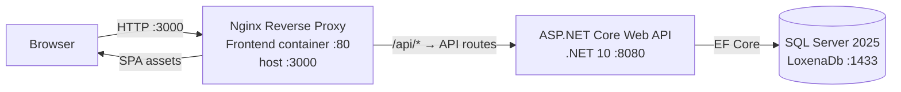
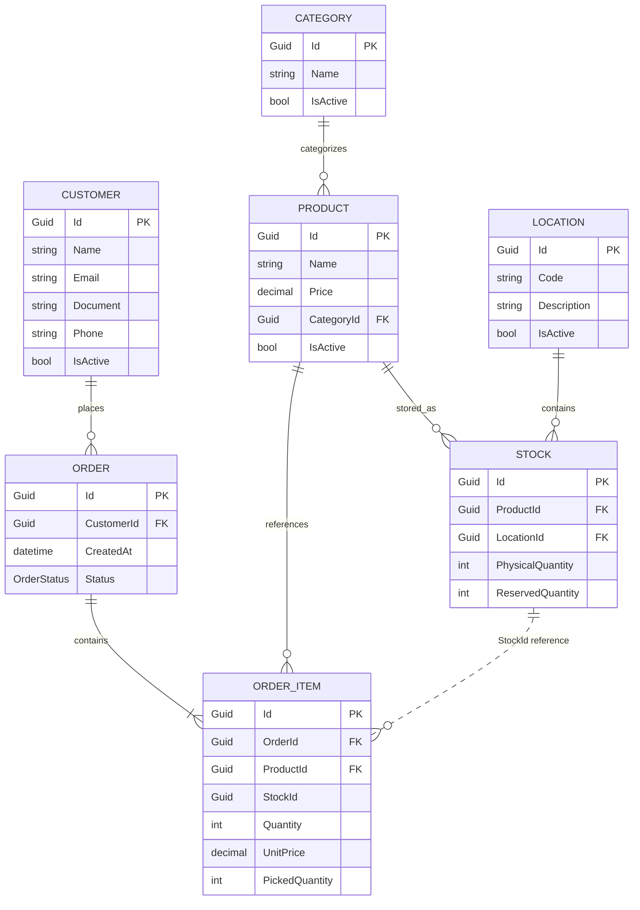

# WMS Loxena

<p align="right"><a href="README-en.md">🇺🇸 English</a></p>


O **Loxena** é um Sistema de Gerenciamento de Armazém (WMS) de portfólio inspirado em operações reais de logística. O projeto modela o fluxo de estoque por localização e o atendimento de pedidos, conectando uma API ASP.NET Core a uma interface React responsiva.

## Visão geral e contexto de negócio

O sistema cobre cadastros de produtos, categorias, localizações e clientes; consulta e movimentação de estoque; criação e acompanhamento de pedidos. O foco é demonstrar regras logísticas concretas em um MVP, sem afirmar que seja um WMS empresarial completo.

- **Saldo por localização:** cada registro de `Stock` associa um produto a uma localização e calcula o disponível como `PhysicalQuantity - ReservedQuantity`. A aplicação valida reservas, baixas e expedições para preservar o saldo comprometido.
- **Concorrência otimista:** `RowVersion` no EF Core detecta conflitos em reservas simultâneas de estoque, retornando HTTP `409 Conflict` para evitar inconsistências.
- **Localizações ocupadas:** uma localização com quantidade física em estoque não pode ser inativada. Um índice filtrado também impede mais de um produto com saldo físico positivo na mesma localização.
- **Pedido com picking:** ao criar pedido, o estoque é reservado. O fluxo exige separação completa antes da conferência e então avança por embalagem, expedição e entrega. A expedição consome físico e reserva.
- **Proteção de clientes:** não é permitido inativar um cliente que possua pedidos ativos.

O pedido percorre `Pending → Picking → Checking → Packing → Shipped → Delivered`; também pode ser cancelado antes da expedição. Não há recebimento formal, confirmação de pagamento, autenticação ou fluxo dedicado de retirada implementados no MVP.

## Arquitetura e decisões técnicas

### Topologia em Docker

No Compose, o Nginx atende a interface na porta `3000` e encaminha `/api/` para a API na rede interna do Docker. A API acessa o SQL Server 2025 pelo serviço `sqlserver`.



### Modelo de domínio

O diagrama representa as entidades registradas no `LoxenaDbContext`. `OrderItem.StockId` identifica o saldo de estoque associado ao item; a entidade não possui navegação EF explícita para `Stock`.



### Clean Architecture e frontend

O backend separa responsabilidades em `Loxena.Domain` (entidades e regras), `Loxena.Application` (casos de uso e contratos), `Loxena.Infrastructure` (EF Core e persistência) e `Loxena.Api` (controllers, configuração HTTP e tratamento global de erros). Os projetos de testes ficam em `tests/UnitTests` e `tests/IntegrationTests`.

O frontend usa React 19, TypeScript, Vite e Tailwind CSS 4. As listas de operação combinam tabelas no desktop e cards no mobile, com busca instantânea filtrada no cliente; a navegação e os controles se adaptam a telas menores.

Principais rotas da API incluem `/Orders`, `/Stocks`, `/Customers`, `/Products`, `/Categories` e `/Locations`. Em execução via Nginx, elas ficam disponíveis sob `/api/` (por exemplo, `/api/Orders`).

## Demonstração visual

Os arquivos de imagem ainda serão adicionados. Coloque os prints e GIFs em `docs/images/` e remova os comentários HTML correspondentes para exibi-los:

<!--  -->
<!--  -->
<!--  -->

## Como executar

### Docker Compose (recomendado)

Requisitos: Docker Engine ou Docker Desktop com o plugin `docker compose`.

Clone o repositório e entre na pasta do projeto:

```bash
git clone https://github.com/jroquebento/Loxena.git
cd Loxena
docker compose up --build -d
```

Acesse **http://localhost:3000**. O Compose inicia SQL Server 2025, API e frontend; a API aplica as migrações do EF Core ao iniciar.
Na primeira inicialização, a API também popula automaticamente o banco com dados de demonstração — categorias, localizações, produtos, clientes e pedidos — para facilitar o teste imediato.

```bash
docker compose ps
docker compose down
```

`docker compose down` preserva o volume do banco. Use `docker compose down -v` somente se também quiser apagar os dados persistidos.

### Desenvolvimento local (opcional)

Requisitos: SDK .NET 10, Node.js 22+ e Docker para disponibilizar SQL Server. O `appsettings.Development.json` espera SQL Server em `localhost:1433` com o banco `LoxenaDb`; é possível iniciar apenas o banco definido no Compose:

```bash
docker compose up -d sqlserver
```

Em um terminal, a partir da raiz, rode a API na porta `8080`, usada pelo proxy do Vite:

```bash
dotnet run --project backend/Loxena.Api/Loxena.Api.csproj --urls http://localhost:8080
```

Em outro terminal:

```bash
cd frontend/loxena-web
npm ci
npm run dev
```

Abra **http://localhost:5173**. O Vite encaminha `/api` para `http://localhost:8080`.

### Exposição temporária com Cloudflare Tunnel

Para expor a versão executada pelo Docker Compose, use a porta `3000`:

```bash
cloudflared tunnel --url http://localhost:3000
```

Se estiver usando o servidor de desenvolvimento Vite, exponha a porta `5173`:

```bash
cloudflared tunnel --url http://localhost:5173
```

Use a URL HTTPS temporária informada pelo `cloudflared`. O túnel torna a aplicação acessível publicamente; não exponha dados reais, credenciais ou ambientes que não devam ser públicos.

## Testes e qualidade

Para executar os testes .NET a partir da raiz:

```bash
dotnet test backend/Loxena.slnx
```

Os projetos `UnitTests` e `IntegrationTests` usam xUnit; os testes de integração dependem de Docker/Testcontainers para SQL Server.

O workflow [GitHub Actions CI](.github/workflows/ci.yml) é acionado em `push` e `pull_request` e possui dois jobs:

- **Backend (.NET 10):** restore, build Release e testes da solução `backend/Loxena.slnx`.
- **Frontend (Node.js 22):** `npm ci` e `npm run build` em `frontend/loxena-web`.

O frontend também disponibiliza `npm run lint` para análise estática local.

## Estrutura do repositório

```text
backend/
  Loxena.Api/
  Loxena.Application/
  Loxena.Domain/
  Loxena.Infrastructure/
  Loxena.slnx
tests/
  UnitTests/
  IntegrationTests/
frontend/
  loxena-web/
docker-compose.yml
README.md
README-en.md
```

Consulte também o [contexto técnico do projeto](docs/project_context.md).
